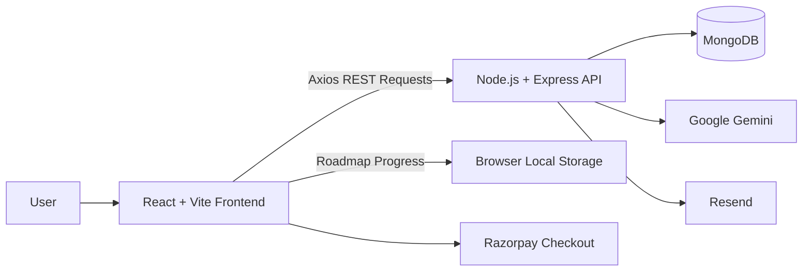

# EntreSkill Hub

> An AI-assisted entrepreneurship platform that helps users turn their skills, budget, and time commitment into practical business ideas, personalised roadmaps, and mentor-led guidance.

EntreSkill Hub is a full-stack web application built to support aspiring entrepreneurs at the idea-to-execution stage. Users can create an account, complete a skills-based onboarding flow, discover suitable business ideas, save favourites, generate AI-powered roadmaps, and explore verified mentors.

## Key Features

- **Authentication and user profiles**  
  Secure registration and login with JWT authentication and bcrypt password hashing.

- **Skills-based onboarding**  
  Collects a user's skills, budget range, and time commitment to personalise the experience.

- **AI business recommendations**  
  Uses Google Gemini to match users with relevant business ideas from the MongoDB catalogue. A JavaScript fallback algorithm is used if the AI request is unavailable.

- **Business idea discovery**  
  Browse business ideas with category filters, keyword search, estimated startup cost, market-demand information, required skills, and AI match reasoning.

- **Bookmarks**  
  Save and remove business ideas directly from the dashboard. Bookmarks are stored in the user profile.

- **AI-generated roadmaps**  
  Creates and saves a structured five-step roadmap for a selected business goal. Each roadmap contains step descriptions, estimated timelines, and suggested resources.

- **Roadmap progress tracking**  
  Users can mark roadmap tasks as complete. Progress is currently saved in browser `localStorage`.

- **Verified mentor directory**  
  Browse verified mentors, filter by expertise, view experience details, and open the mentor session-booking flow.

- **Razorpay checkout interface**  
  Includes a client-side Razorpay Checkout flow for mentor-session payments.

- **AI support assistant**  
  A Gemini-backed chatbot answers questions related to the EntreSkill platform, roadmaps, skill building, and mentorship.

- **Support contact form**  
  Sends user support requests to the configured inbox through Resend.

## Architecture



## Technology Stack

| Layer | Technologies |
|---|---|
| Frontend | React 19, Vite 8, React Router, Axios |
| UI | Tailwind CSS, React Icons |
| Backend | Node.js, Express 5 |
| Database | MongoDB, Mongoose |
| Authentication | JSON Web Tokens, bcryptjs |
| Artificial Intelligence | Google Gemini |
| Email | Resend |
| Payments UI | Razorpay Checkout |
| Deployment configuration | Vercel frontend configuration and Render API host references |

## Application Flow

1. A user creates an account or signs in.
2. The onboarding flow records skills, budget, and time commitment.
3. The dashboard retrieves the profile and business recommendations.
4. Gemini selects suitable ideas from the stored idea catalogue; the fallback matcher is used if needed.
5. The user can search, filter, bookmark, and open business ideas.
6. Selecting an idea creates a personalised five-step AI roadmap.
7. The user can track roadmap tasks and explore mentor support.

## Project Structure

```text
entreskill-hub/
├── backend/
│   ├── config/
│   │   └── db.js
│   ├── controllers/
│   │   ├── aiController.js
│   │   ├── authController.js
│   │   ├── bookmarkController.js
│   │   ├── chatBotController.js
│   │   ├── mentorController.js
│   │   ├── recommendationController.js
│   │   └── supportController.js
│   ├── middleware/
│   │   └── authMiddleware.js
│   ├── models/
│   │   ├── BusinessIdea.js
│   │   ├── Mentor.js
│   │   ├── Roadmap.js
│   │   ├── Skill.js
│   │   └── User.js
│   ├── routes/
│   ├── server.js
│   └── package.json
│
└── frontend/
    ├── src/
    │   ├── components/
    │   ├── pages/
    │   ├── App.jsx
    │   ├── index.css
    │   └── main.jsx
    ├── vercel.json
    └── package.json
```

## Getting Started

### Prerequisites

- Node.js LTS
- npm
- MongoDB database
- Google Gemini API key
- Resend API key

### 1. Clone the repository

```bash
git clone https://github.com/sonukumawat-sde/entreskill-hub.git
cd entreskill-hub
```

### 2. Configure the backend

Create a `backend/.env` file:

```env
MONGO_URI=your_mongodb_connection_string
JWT_SECRET=your_secure_jwt_secret
GEMINI_API_KEY=your_google_gemini_api_key
RESEND_API_KEY=your_resend_api_key
EMAIL_USER=your_support_inbox@example.com
PORT=5000
```

Install dependencies and start the server:

```bash
cd backend
npm install
npm run dev
```

The backend runs on:

```text
http://localhost:5000
```

### 3. Start the frontend

Open a second terminal:

```bash
cd frontend
npm install
npm run dev
```

The Vite frontend runs on:

```text
http://localhost:5173
```

> **Local development note:** Some frontend pages currently reference the deployed Render API URL directly. To run the complete project locally, replace those URLs with `http://localhost:5000` or move the API base URL into a Vite environment variable.

## Available Scripts

### Frontend

```bash
npm run dev
npm run build
npm run lint
npm run preview
```

### Backend

```bash
npm start
npm run dev
```

## API Reference

### Health Check

| Method | Endpoint | Description |
|---|---|---|
| `GET` | `/` | Returns a basic API status message |

### Authentication

| Method | Endpoint | Access | Description |
|---|---|---|---|
| `POST` | `/api/auth/register` | Public | Register a new user and return a JWT |
| `POST` | `/api/auth/login` | Public | Authenticate an existing user |
| `GET` | `/api/auth/profile` | Protected | Get the current user profile |
| `POST` | `/api/auth/onboarding` | Protected | Save skills, budget, and time commitment |
| `PUT` | `/api/auth/profile` | Protected | Update user profile details |

### AI and Recommendations

| Method | Endpoint | Access | Description |
|---|---|---|---|
| `POST` | `/api/ai/match` | Public | Get AI-assisted business recommendations |
| `POST` | `/api/ai/generate-roadmap` | Public | Generate and save a five-step roadmap |
| `GET` | `/api/recommendations/seed` | Public | Seed the database with 12 business ideas |
| `POST` | `/api/recommendations/match` | Protected | Match ideas using user skills |
| `GET` | `/api/recommendations/all` | Protected | Retrieve all business ideas |
| `GET` | `/api/recommendations/:id` | Protected | Retrieve one business idea |

### Bookmarks

| Method | Endpoint | Access | Description |
|---|---|---|---|
| `GET` | `/api/bookmarks` | Protected | Retrieve bookmarked business ideas |
| `POST` | `/api/bookmarks/toggle` | Protected | Add or remove a bookmarked idea |

### Mentors, Support, and Chat

| Method | Endpoint | Access | Description |
|---|---|---|---|
| `POST` | `/api/mentors/register` | Public | Register a mentor for verification |
| `GET` | `/api/mentors` | Public | Retrieve verified mentors |
| `GET` | `/api/mentors/:id` | Public | Retrieve a mentor by ID |
| `POST` | `/api/chatbot/ask` | Public | Send a question to the AI assistant |
| `POST` | `/api/support/contact` | Public | Send a support request through Resend |

## Data Models

| Model | Purpose |
|---|---|
| `User` | Stores account details, skills, onboarding data, bookmarks, mentor credits, and streaks |
| `BusinessIdea` | Stores startup ideas, required skills, costs, categories, demand, and roadmaps |
| `Roadmap` | Stores AI-generated user-specific roadmaps |
| `Mentor` | Stores mentor details, expertise, experience, bio, LinkedIn profile, and verification status |
| `Skill` | Stores reusable skill names and categories |

## Current Implementation Notes

- Gemini is used for AI matching, roadmap generation, and chatbot responses.
- AI recommendation and roadmap generation include fallback logic if Gemini fails.
- The dashboard can filter ideas by category and search text.
- Bookmark data is stored in the authenticated user document.
- Roadmap completion state is stored locally in the browser.
- Only mentors with `isVerified: true` appear in the mentor directory.
- Razorpay Checkout is currently initiated from the frontend; backend payment verification and booking persistence are not part of the current codebase.
- The frontend includes Vercel configuration, while the API URLs reference a Render-hosted backend.

## Development Status

The frontend includes linting and production build scripts:

```bash
cd frontend
npm run lint
npm run build
```

An automated test suite is not currently configured in the repository.

## Security Notes

- Do not commit `.env` files or secret API keys.
- Use a strong `JWT_SECRET`.
- Restrict the public seed endpoint before production deployment.
- Add backend payment verification before accepting production payments.
- Add rate limiting and request validation for a production environment.

## License

No license file is currently included in the repository.
