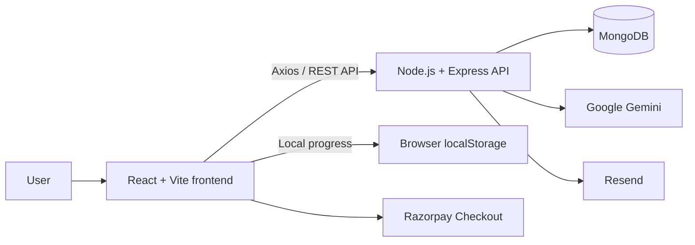

# EntreSkill Hub

> An AI-assisted entrepreneurship platform that helps aspiring founders turn their skills, budget, and available time into practical business ideas, structured roadmaps, and mentor-led next steps.

EntreSkill Hub guides users from “What can I build?” to “What should I do next?” Users create an account, complete a skill-and-budget assessment, receive personalised business recommendations, save ideas, generate AI roadmaps, and explore verified mentors.

## Features

- **Secure user accounts** — JWT-based registration and login with hashed passwords.
- **Guided onboarding** — Captures skills, initial budget, and time commitment.
- **AI business recommendations** — Gemini-powered recommendations with a JavaScript fallback.
- **Idea discovery and bookmarks** — Browse, filter, search, and save business ideas.
- **AI-generated roadmaps** — Generates and stores a five-step roadmap for a selected goal.
- **Roadmap progress tracking** — Users can mark tasks complete; progress is stored locally in the browser.
- **Mentor directory** — Browse verified mentors and use the session-booking interface.
- **Support contact form** — Sends support requests through Resend.
- **AI support assistant** — Gemini-backed chatbot for platform and entrepreneurship guidance.
- **Responsive interface** — Built with React and Tailwind CSS.

## Architecture



## Technology Stack

| Area | Technologies |
|---|---|
| Frontend | React 19, Vite 8, React Router, Axios, Tailwind CSS, React Icons |
| Backend | Node.js, Express 5 |
| Database | MongoDB with Mongoose |
| Authentication | JSON Web Tokens and bcryptjs |
| AI | Google Gemini via `@google/generative-ai` |
| Email | Resend |
| Payments UI | Razorpay Checkout |
| Deployment configuration | Vercel frontend configuration and Render API URL |

## Application Flow

1. A user registers or signs in.
2. The onboarding flow records skills, budget, and time commitment.
3. The dashboard loads relevant business ideas and requests AI-assisted matches.
4. The user can filter ideas, bookmark favourites, and open a selected idea.
5. EntreSkill Hub generates a five-step AI roadmap and stores it in MongoDB.
6. The user tracks roadmap tasks and can explore verified mentors.

## Repository Structure

```text
entreskill-hub/
├── backend/
│   ├── config/
│   │   └── db.js
│   ├── controllers/
│   │   ├── aiController.js
│   │   ├── authController.js
│   │   ├── bookmarkController.js
│   │   ├── chatBotController.js
│   │   ├── mentorController.js
│   │   ├── recommendationController.js
│   │   └── supportController.js
│   ├── middleware/
│   │   └── authMiddleware.js
│   ├── models/
│   ├── routes/
│   ├── server.js
│   └── package.json
└── frontend/
    ├── src/
    │   ├── components/
    │   ├── pages/
    │   ├── App.jsx
    │   └── main.jsx
    ├── vercel.json
    └── package.json
```

## Getting Started

### Prerequisites

- Node.js LTS
- npm
- MongoDB database
- Google Gemini API key
- Resend API key

### 1. Clone the repository

```bash
git clone https://github.com/sonukumawat-sde/entreskill-hub.git
cd entreskill-hub
```

### 2. Configure the backend

Create `backend/.env` locally. Never commit this file.

```env
MONGO_URI=your_mongodb_connection_string
JWT_SECRET=use_a_long_random_secret
GEMINI_API_KEY=your_google_gemini_api_key
RESEND_API_KEY=your_resend_api_key
EMAIL_USER=your_support_inbox@example.com
PORT=5000
```

Install dependencies and start the API:

```bash
cd backend
npm install
npm run dev
```

The backend starts at `http://localhost:5000`.

### 3. Configure and start the frontend

Open another terminal:

```bash
cd frontend
npm install
npm run dev
```

Vite serves the frontend at `http://localhost:5173`.

> **Local-development note:** The current frontend uses the deployed Render API URL. To connect it to your local backend, replace those URLs with `http://localhost:5000` or introduce a `VITE_API_BASE_URL` environment variable.

## Available Scripts

### Frontend

```bash
npm run dev
npm run build
npm run lint
npm run preview
```

### Backend

```bash
npm start
npm run dev
```

## API Overview

### Authentication

| Method | Endpoint | Access | Purpose |
|---|---|---|---|
| `POST` | `/api/auth/register` | Public | Create an account and receive a JWT |
| `POST` | `/api/auth/login` | Public | Authenticate an existing user |
| `GET` | `/api/auth/profile` | Protected | Retrieve the current profile |
| `POST` | `/api/auth/onboarding` | Protected | Save onboarding data |
| `PUT` | `/api/auth/profile` | Protected | Update profile details |

### Recommendations and Roadmaps

| Method | Endpoint | Access | Purpose |
|---|---|---|---|
| `POST` | `/api/ai/match` | Public | Return AI-assisted business recommendations |
| `POST` | `/api/ai/generate-roadmap` | Public | Generate and store a five-step roadmap |
| `GET` | `/api/recommendations/seed` | Public | Seed 12 sample business ideas |
| `POST` | `/api/recommendations/match` | Protected | Return matches based on skills |
| `GET` | `/api/recommendations/all` | Protected | Retrieve all business ideas |
| `GET` | `/api/recommendations/:id` | Protected | Retrieve one business idea |

### Bookmarks, Mentors, and Support

| Method | Endpoint | Access | Purpose |
|---|---|---|---|
| `GET` | `/api/bookmarks` | Protected | Retrieve saved ideas |
| `POST` | `/api/bookmarks/toggle` | Protected | Add or remove a saved idea |
| `POST` | `/api/mentors/register` | Public | Register a mentor |
| `GET` | `/api/mentors` | Public | Retrieve verified mentors |
| `GET` | `/api/mentors/:id` | Public | Retrieve a mentor |
| `POST` | `/api/chatbot/ask` | Public | Send a chatbot message |
| `POST` | `/api/support/contact` | Public | Submit a support request |

## Data Model

The application uses MongoDB collections for:

- **Users** — Authentication, role, skills, budget, bookmarks, mentor credits, and streaks.
- **Business ideas** — Descriptions, required skills, costs, categories, demand, and roadmaps.
- **Roadmaps** — User-specific AI-generated five-step plans.
- **Mentors** — Mentor details, expertise, experience, and verification status.
- **Skills** — Skill records for categorisation.

## Current Implementation Notes

- Gemini recommendations and roadmaps include fallback logic if AI requests fail.
- Roadmap completion is currently stored in browser `localStorage`.
- The mentor directory displays verified mentors.
- Razorpay currently uses a client-side test checkout flow.
- Backend CORS allows the local Vite app and deployed Vercel frontend.

## Security and Repository Hygiene

Before production deployment:

- Never commit `.env` files or API keys.
- Add `node_modules/` to `.gitignore`.
- Protect or remove the public database seed endpoint.
- Store frontend API URLs in environment configuration.
- Add server-side Razorpay payment verification.
- Add rate limiting, input validation, and automated tests.

## Contributing

1. Create a feature branch.
2. Keep commits focused and descriptive.
3. Run `npm run lint` and `npm run build` in `frontend/`.
4. Never commit credentials, generated dependencies, or build output.

## License

No license file is currently included. Add an appropriate license before defining reuse or redistribution terms.
